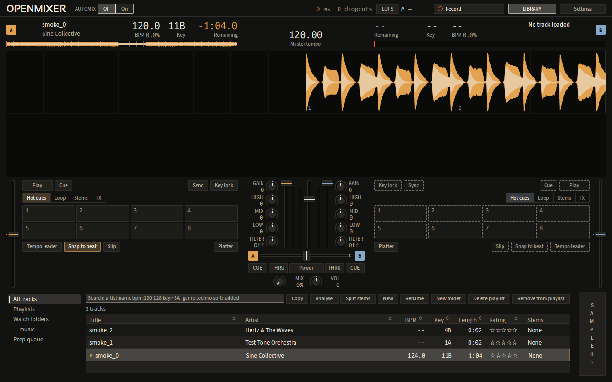
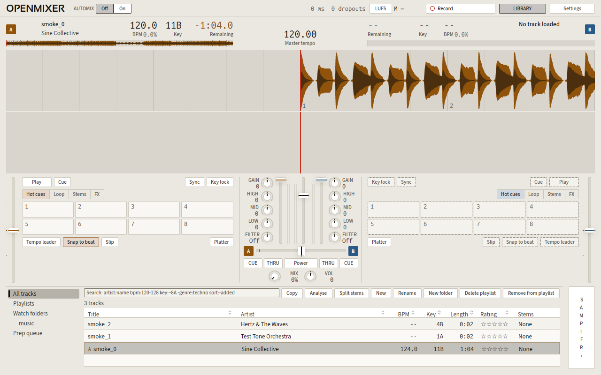
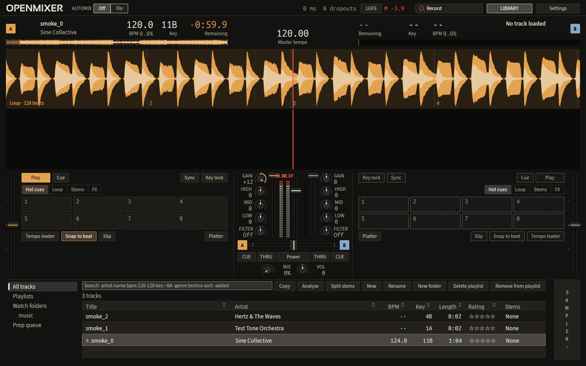
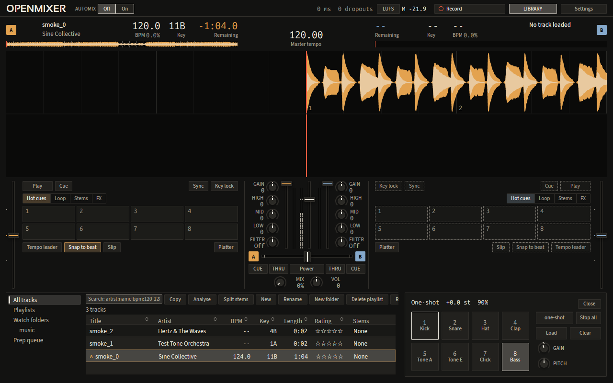
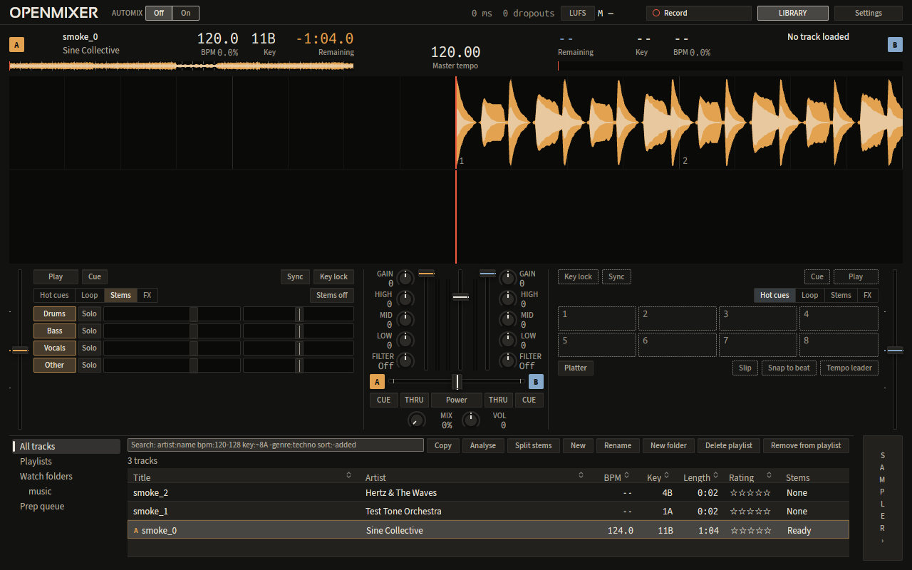

# OpenMixer DJ

OpenMixer DJ is a free, open-source DJ application: Linux first, with Windows and macOS to follow. Website: [openmixer.dev](https://openmixer.dev).

OpenMixer DJ is not affiliated with [openmixer.org](https://openmixer.org), a live-sound mixing console, or with the OpenMixer routing mixer from Stanford's CCRMA.



| Daylight theme | Meters lit | Sampler | Stems |
|---|---|---|---|
|  |  |  |  |

## Goals

A program a working DJ would choose over what they use now: multi-deck mixing, effects, sync, BPM and key analysis, stem separation, Automix and controller support, with an interface that reads at a glance. The product bar is in [docs/PRODUCT.md](docs/PRODUCT.md).

OpenMixer is a clean-room implementation ([ADR 0001](docs/adr/0001-clean-room-doctrine.md)). Features and workflows are methods of operation and free to implement; names, logos, artwork, icons, manual text, sound packs, presets and pixel layouts of other DJ programs are not copied. No Mixxx code is used. AI model weights are downloaded on first use from their official sources, with their licences shown, and are not bundled.

## Technology

Rust, with a [Tauri v2](https://tauri.app/) window and a Svelte front end ([ADR 0009](docs/adr/0009-web-front-end-tauri-trial.md)). The real-time engine never allocates, locks or makes syscalls on the audio thread. See [docs/crates.md](docs/crates.md) for what each crate owns.

## Building

Install Rust with [rustup](https://rustup.rs/); the toolchain is pinned in `rust-toolchain.toml`. On Ubuntu or Debian:

```bash
sudo apt-get install pkg-config libasound2-dev libclang-dev libdbus-1-dev libwebkit2gtk-4.1-dev
```

```bash
git clone https://github.com/massive-development/openmixer.git
cd openmixer
cargo build
cargo test --workspace
cargo run -p openmixer -- --mock-device     # open the window without a sound card
```

Lint gates, soak and UI tests, benchmarks, optional features (`clap`, `onnx`, `ffmpeg`, `gui-tauri`), environment variables and the Tauri window are covered in [docs/guidelines/build.md](docs/guidelines/build.md). Build problems, including WSL, are in [docs/troubleshooting.md](docs/troubleshooting.md).

## Project layout

```
crates/
├── om-core/       Typed control surface (ParamId, Command), engine snapshot, routing; no I/O
├── om-dsp/        Filters, EQ, meters and crossfader curves
├── om-engine/     Audio-thread engine: decks, mixer, FX, sync, loops, sampler, recorder, loudness
├── om-audio/      Device layer over cpal, a headless mock device, the output router
├── om-stretch/    Rubber Band key-lock time-stretch (FFI)
├── om-analysis/   BPM, key, waveform and structure analysis with a SQLite cache
├── om-library/    Track library, metadata ingest, iTunes and Rekordbox import, search
├── om-automix/    Automix planner, controller and queue
├── om-midi/       Controller maps, MIDI learn and feedback
├── om-stems/      Stem separation pipeline and verified model downloads
├── om-plugins/    Plugin API, C-ABI loading and CLAP hosting
├── om-ui/         UI logic without a window: themes, preferences, view models
├── om-ui-bridge/  Wire formats for the web front end
├── om-ui-tauri/   Tauri v2 window and Svelte front end (the default window)
├── om-testing/    Shared test helpers
└── openmixer/     Binary and composition root
examples/          Example plugins (in-process, C-ABI, CLAP)
fixtures/          Small test inputs
resources/         Controller maps, fonts and built-in themes
tools/             Packaging, UI drive and benchmark scripts
```

## Status

Pre-release. On Linux the audio engine, analysis, library, MIDI mapping, plugins and the Tauri window's decks screen work and are tested headlessly. The interface and stem separation are still in progress, and nothing has yet been confirmed on real hardware or by ear. Built-in themes: Midnight Glass (default), Daylight Frost and Harbour Night.

What is planned is in [ROADMAP.md](ROADMAP.md). Work that is built but not yet verified is tracked in [Known gaps](https://github.com/massive-development/openmixer/issues/283), and [docs/testing/hardware-checklist.md](docs/testing/hardware-checklist.md) lists what to check on a real device.

Not planned: Spotify integration (its terms prohibit DJ mixing), mobile apps, and real-time stem separation (stems are computed ahead of time).

## Documentation

| Document | Contents |
|---|---|
| [docs/PRODUCT.md](docs/PRODUCT.md) | The product bar every area is measured against |
| [ROADMAP.md](ROADMAP.md) | Tracks, milestones and key decisions |
| [docs/adr/](docs/adr/INDEX.md) | Architecture decision records |
| [docs/DESIGN_PATTERNS.md](docs/DESIGN_PATTERNS.md) | Design patterns in use and when to reuse them |
| [CONTRIBUTING.md](CONTRIBUTING.md) | How to contribute |
| [SECURITY.md](SECURITY.md) | Reporting a vulnerability |

## Contributing

See [CONTRIBUTING.md](CONTRIBUTING.md). Bugs and feature requests go in [issues](https://github.com/massive-development/openmixer/issues/new/choose); security reports go through [SECURITY.md](SECURITY.md). For anything else, write to contact@openmixer.dev.

## License

GNU Affero General Public License v3.0. See [LICENSE](LICENSE).
