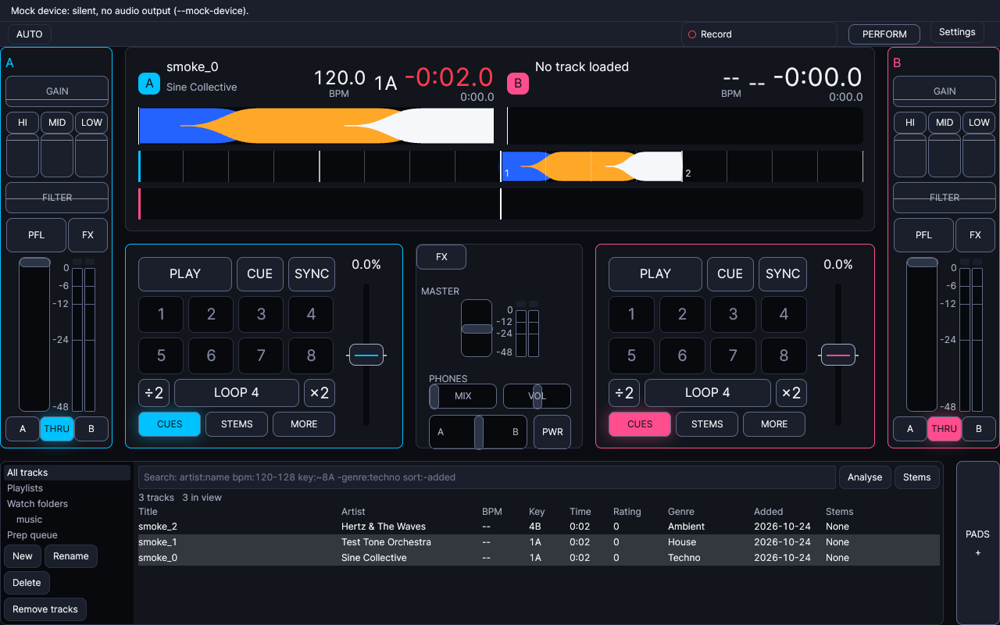
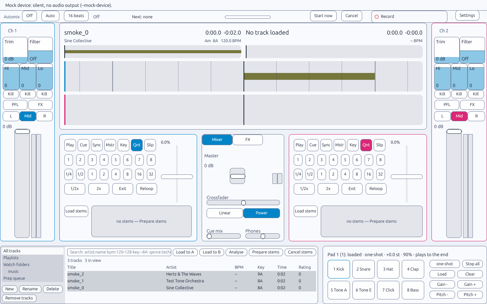
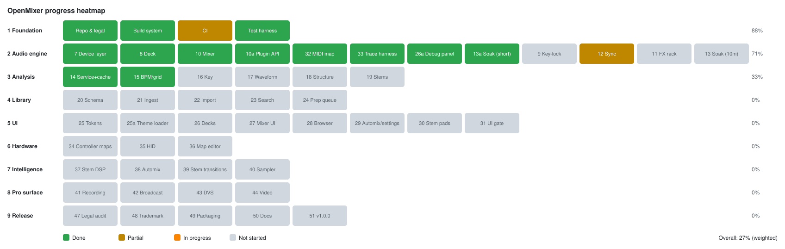

# OpenMixer

A free, open-source DJ application: Linux first, with Windows and macOS support to follow.

## Screenshots

Regenerate with `tools/screenshots.sh` (see `docs/screenshots/REVIEW.md` for known visual defects).

- Main window, dark theme: 
- Main window, daylight theme: 

## Mission

OpenMixer is a clean-room, legally original implementation of professional DJ software features. Our goal is a program a working DJ would choose over what they use now: djay-Pro-class capability (multi-deck mixing, effects, sync, BPM/key analysis, stem separation, Automix, controller support) with an interface that reads at a glance, all without copying any copyrighted expression from existing applications. The bar is in [docs/PRODUCT.md](docs/PRODUCT.md).

## Clean-Room Statement

OpenMixer is built under a strict clean-room doctrine:

- **Functional features are free** - mixing workflows, deck layouts, BPM detection, sync mechanisms, and other operational concepts are methods of operation, not copyrightable expression
- **Expression is not copied** - no names, logos, artwork, icons, screenshots, manual text, sound packs, FX presets, or pixel-copying of screen layouts
- **No Mixxx code** - while we use the same open-source audio libraries (GPL-licensed), our implementation is entirely original
- **No proprietary assets** - AI model weights are downloaded on first use from official sources with licenses shown; no content is bundled

## Technology

OpenMixer is written in Rust with [GPUI](https://www.gpui.rs/) for the UI. The stack decision is in [ADR 0004](docs/adr/0004-stack-rust-gpui.md).


## Documentation

| Document | Purpose |
|----------|---------|
| [README.md](README.md) | Project overview (this file) |
| [docs/PRODUCT.md](docs/PRODUCT.md) | **What the product has to be: the bar every area is measured against** |
| [ROADMAP.md](ROADMAP.md) | Tracks, waves and key decisions |
| [agents.md](agents.md) | **AI Agent setup and implementation guide** |
| [CONTRIBUTING.md](CONTRIBUTING.md) | Contribution guidelines |
| [TODO.md](TODO.md) | Implementation task list |
| [docs/DESIGN_PATTERNS.md](docs/DESIGN_PATTERNS.md) | Design patterns in use and when to reuse them |
| [docs/PROGRESS.md](docs/PROGRESS.md) | Per-task progress, gaps, and where to help |
| [docs/adr/INDEX.md](docs/adr/INDEX.md) | Architecture decisions |
| [docs/legal/](docs/legal/) | Legal documentation |

## Building

### Prerequisites

Install the Rust toolchain with [rustup](https://rustup.rs/). The toolchain version is pinned in `rust-toolchain.toml`; `rustfmt` and `clippy` are installed with it.

**Ubuntu/Debian:**
```bash
sudo apt-get install pkg-config libasound2-dev
```

GPUI system dependencies are documented in `docs/spikes/gpui.md`.

**macOS and Windows:** not runtime targets yet (Windows and macOS support is later). CI checks Linux only, so no extra system packages are listed for them yet.

Optional, for the licence and ban policy check:
```bash
cargo install cargo-deny
```

### Build Steps

```bash
# Clone the repository
git clone https://github.com/massive-development/openmixer.git
cd openmixer

# Build the workspace
cargo build

# Run tests
cargo test --workspace

# Engine soak: 30 s paced mix with a scripted DJ (also in cargo test --workspace)
cargo test -p om-audio --test soak
# 10-minute soak (Wave 2 gate, not in CI): takes 10 minutes of wall time
cargo test -p om-audio --test soak -- --ignored --nocapture

# UI gate: scripted DJ over the composition on a paced mock device, no display (8 s; 10-minute run is --ignored)
cargo test -p openmixer --test ui_gate
cargo test -p openmixer --test ui_gate -- --ignored --nocapture

# Format, lint and policy checks (same as CI)
cargo fmt --all --check
cargo clippy --workspace --all-targets -- -D warnings
cargo deny check

# Headless binary (no window, no GPUI system libraries at run time)
cargo test -p openmixer --no-default-features
```

### Running on WSL

GPUI renders through Vulkan, so the GUI on WSL depends on a working Vulkan driver as well as the display path. WSLg Vulkan can be fragile; check it with `vulkaninfo --summary` (from `vulkan-tools`) before debugging the app itself.

To run the GUI on Windows Subsystem for Linux (WSL):

**Windows 11 (WSLg):**
```bash
# Edit /etc/wsl.conf
[guiApplications]
enabled=true

# Restart WSL
wsl --shutdown
```

**Windows 10 or custom XServer:**
```bash
# Install and run VcXsrv or Xming on Windows
# Set DISPLAY environment variable
export DISPLAY=127.0.0.1:0

```

### Running

```bash
cargo run -p openmixer -- --mock-device              # the window (dev builds optimise the UI crates; use --release to judge smoothness)
cargo run -p openmixer -- --headless --smoke         # startup check, no window
cargo run -p openmixer -- --version
```

The GPUI window is the default build and needs the `-dev` packages listed in the `check` job of `.github/workflows/rust.yml` (on Linux: `libxkbcommon-x11-dev`, Wayland, fontconfig, freetype, Vulkan). `--no-default-features` builds the headless binary without it. The staged screenshots were checked by eye (see `docs/screenshots/REVIEW.md`); a live window on a real display, at the minimum size, has not been checked.

Set `OPENMIXER_FRAME_STATS=1` to print frame-time percentiles to the terminal every five seconds.

### Debug Build

```bash
cargo build
cargo run -p openmixer -- --smoke

# Check for memory leaks (Linux, requires valgrind)
valgrind --leak-check=full ./target/debug/openmixer --smoke
```

## Architecture

A Cargo workspace. Dependency arrows point toward `om-core`, which has no I/O.

```
crates/
├── om-core/      # Typed control surface (ParamId, Command), pulled engine snapshot, job queue, routing; no I/O
├── om-dsp/       # Filters, EQ, sweep filter, meters and crossfader curves
├── om-engine/    # Audio-thread engine: decks, mixer, FX racks, sync, quantizer, loops, sampler and recorder
├── om-audio/     # Device layer over cpal, a headless mock device, the output router
├── om-stretch/   # Rubber Band R3 key-lock time-stretch via FFI (the one crate allowed unsafe)
├── om-analysis/  # BPM, key, waveform and structure analysis; job service and SQLite cache
├── om-library/   # SQLite library, metadata ingest, iTunes and Rekordbox import, search, prep queue
├── om-automix/   # Automix planner, controller and queue (control side only; no audio thread)
├── om-midi/      # Controller maps, MIDI learn, feedback, trace replay; ALSA sequencer and mock backends
├── om-stems/     # Stem model manifests, licence-gated verified downloads; ONNX backend behind the `onnx` feature (off by default)
├── om-plugins/   # In-process plugin API and registry; C-ABI shared-library loading
├── om-ui/        # UI logic without a window: themes, preferences, mixer, deck and library view models
├── om-ui-gpui/   # GPUI window (the openmixer `gui` feature, on by default)
├── om-testing/   # Test-only helpers shared by the crates (WAV fixtures, signal generators); dev-dependency only
└── openmixer/    # Binary and composition root: --smoke, --mock-device, settings, plugins
examples/plugins/gain-plugin/           # Example in-process plugin
examples/plugins/gain-plugin-cdylib/    # Example C-ABI plugin, built as a shared library
fixtures/                               # Small test inputs: controller maps and traces, library exports
resources/fonts/                        # Bundled Inter (SIL OFL 1.1) interface font
resources/themes/                       # Built-in theme JSON
```

Real-time audio code lives in `om-engine` and `om-audio`. It must not allocate, take locks or make syscalls on the audio thread. The UI sends typed `Command::Param`s to the router through `CommandSink`. MIDI mappings and plugins use the string façade, which parses each id once at the router. Readers pull an `EngineSnapshot` built from the engine's atomics. `agents.md` lists what each crate owns and how to add a control id.

## Implementation Waves



| Wave | Focus | Status |
|------|-------|--------|
| 1 | Foundation, build system, CI, test harness | ✅ Done |
| 2 | Audio engine (device, decks, mixer, FX, sync, MIDI input, soak gate) | 🟡 Partial: the debug panel (26a) is partial (no faders, EQ or meters on it); FFmpeg (8b) is optional and sampler-only; the 10-minute soak is on the weekly CI job, not yet run |
| 3 | Analysis pipeline | 🟡 Partial: stem separation runs on the mock separator; the htdemucs export and a real-model run (19) are open |
| 4 | Library and data | 🟡 Done except crates and tags, the Traktor and Serato importers, smart filters and ranking |
| 5 | User interface | 🟡 Partial: LookAndFeel (25) is partly restyled; decks, mixer and settings partial; stem pads (30) done at logic and view level |
| 6 | Hardware I/O | 🟡 Partial: MIDI input and mapping are done (32 and 33 are in Wave 2); the mapping editor (36) is in at logic and view level (Settings > Mapping, MIDI learn into it; not verified with hardware); controller maps (34) and HID (35) are open |
| 7 | Intelligence (stems, Automix, sampler) | 🟡 Partial: stem playback and the 8-pad sampler (engine, sample bank, pad strip; not heard) are in; Automix is in (planner, controller, library queue, Automix settings page, main-window bar; not heard, mock device only); stem separation is unproven; stem transitions are tested on the engine, not heard |
| 8 | Pro features (recording, broadcast, DVS, video) | 🟡 Partial: mix recording (master-output WAV, ids, prefs, Recording settings tab, header Record button and `r` shortcut; not heard); broadcast, DVS and video not started |
| 9 | Release | ⬜ Not started |

The engine, analysis, library and MIDI work is verified headlessly on Linux; the Wave 5 UI is partial. Next: the Before-Wave-7 list in [TODO.md](TODO.md), then Wave 7.

See [TODO.md](TODO.md) for the task list and [docs/PROGRESS.md](docs/PROGRESS.md) for what each task entails, what is done, and what is missing.

## Important Notices

- **No Spotify integration** - Spotify's terms of service prohibit DJ mixing operations
- **No mobile/web app** - the current development focuses on desktop platforms
- **Stems are precomputed** - stem separation runs offline; real-time separation is not promised

## License

OpenMixer is released under the GNU Affero General Public License v3.0 (AGPLv3). See [LICENSE](LICENSE) for details.

## Contributing

For contributors, see [CONTRIBUTING.md](CONTRIBUTING.md). All contributions must follow the clean-room doctrine outlined in [docs/adr/0001-clean-room-doctrine.md](docs/adr/0001-clean-room-doctrine.md).

## Status

**Current State:** Works, verified headlessly on Linux: the audio engine (two decks, mixer, FX racks, sync, key-lock), analysis (BPM, key, waveform, structure), the library (ingest, import, search, prep queue), MIDI (ALSA sequencer, mapping and feedback), in-process and C-ABI plugins, and the GPUI app on Linux. Partial: the UI (decks, mixer, settings, debug panel) and stems (mock separator only). The staged screenshots were checked by eye; a live window on a real display has not been. Windows and macOS support is later. **Next:** the Before-Wave-7 list in `TODO.md`, then Wave 7. See `docs/spikes/DECISIONS.md`.

**Known gaps, honestly listed:**

- Automix is not verified by ear (mock device only). It asks the prep queue to analyse tracks it had to skip as not analysed (up to 3 times per track, then it gives up and reports via `last_error`); that retry loop is not heard by ear. Stem transitions (Todo 39) are tested on the engine but not heard; the stem separation backend (Todo 19) is still open
- The real htdemucs model (Todo 19): the export script and I/O contract match Demucs on a reference segment (`crates/om-stems/tests/htdemucs_reference.rs`), but nothing has been listened to. The ONNX backend is behind the off-by-default `onnx` feature, and its CI job blocks merges. The separator interface and the licence-gated downloads are done
- HID (Todo 35) and plug-and-play controller maps (Todo 34). The mapping editor (Todo 36) is done at logic and view level; it is not verified with hardware
- Dynamic plugin loading (Todo 10a): shared libraries load over a versioned C ABI (`PluginLoader::load`, ADR in `docs/spikes/DECISIONS.md`) and are tested with in-tree plugins only; nothing third-party has been tried. Plugins must catch their own panics, and the vtable has no prepare, sample-rate or parameters yet
- Windows (WASAPI) and macOS (CoreAudio) runtime targets: later. The cpal device has not been run on a real ALSA or PipeWire device
- Visual verification of the GPUI window: the UI verification gate (Todo 31) runs at the logic layer. The staged screenshots were checked by eye (`docs/screenshots/REVIEW.md`), but no live window on a real display has been checked
- LookAndFeel (25): `om_ui::style` derives every control style from the tokens and the gpui controls draw from it; the library table, its scroll thumb and the automix switch draw from the new scroll bar, table and toggle styles; the platter switch, toggle pills, MIDI toggles, settings page and debug column are still on the old paths, and nothing has been checked on a live display. See "Styling a control" in `agents.md`. The debug panel's per-deck load and play (26a) is wired
- FFmpeg decode backend (Todo 8b, optional `ffmpeg` cargo feature, off by default): wired only into the sampler's `Sample::load`; decks, stems and analysis have no fallback. CI runs the fake-ffmpeg tests only; the real-ffmpeg tests skip where no ffmpeg is installed, and neither the dev environment nor CI has one
- Cover art shows in the deck card header only (PNG and JPEG; no track detail view; the cache is not invalidated on rescan); not seen on a display
- Playlist editing (Todo 28): reorder by dragging a track onto a row, a top-level New folder and nesting by drag are built; the gpui drag and drop is compile-checked only, not seen on a display
- The weekly `soak` CI job (the two 10-minute soaks, `.github/workflows/rust.yml`, Sunday 03:00 UTC) has not run yet: `gh run list --event schedule` is empty (checked 2026-10-27), so the result is unknown
- CI is Linux only; macOS and Windows legs are not in the check matrix
- The headphone-cue second stream is unproven (it failed on WSLg)
- The window-opening `--smoke` (without `--headless`) is not run in CI

---

Built with ❤️ for the DJ community.
