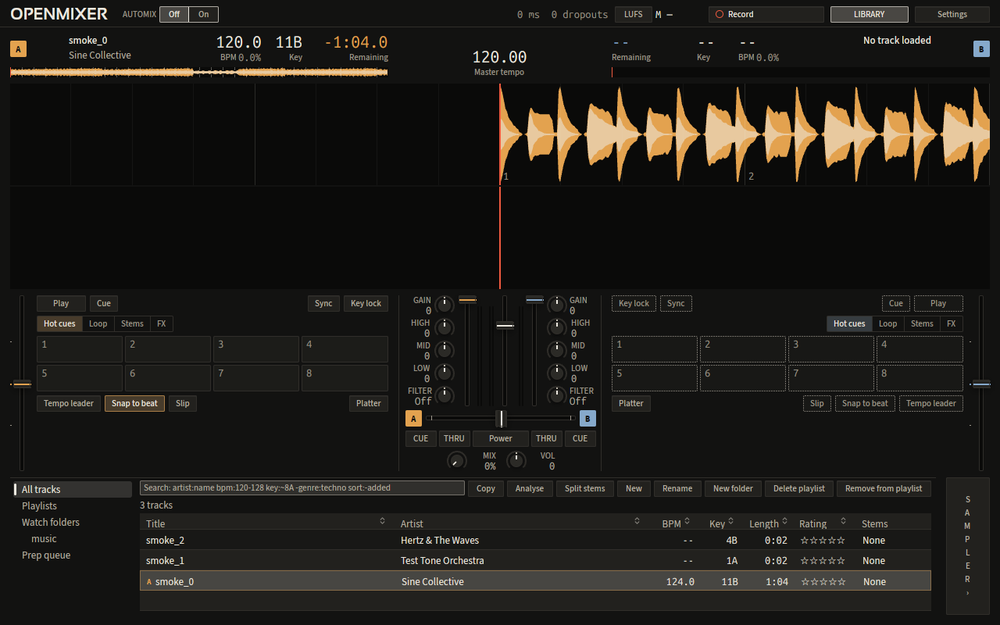
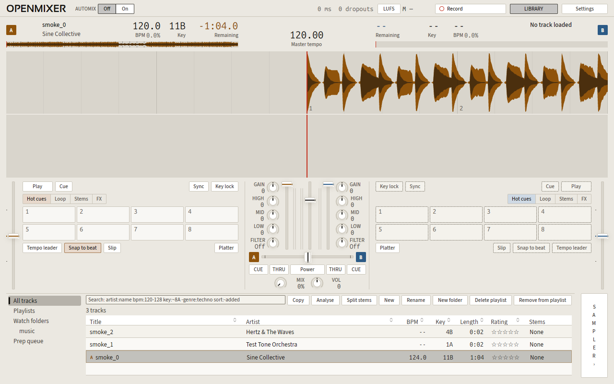
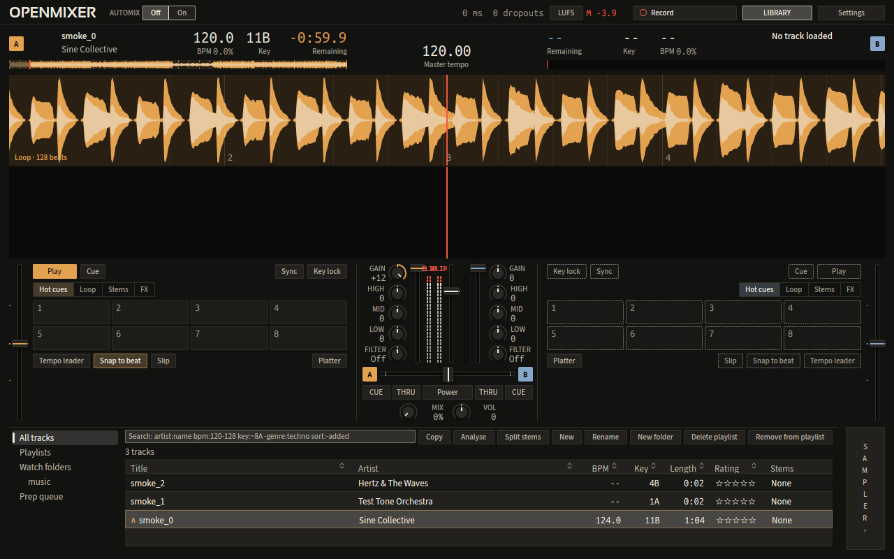
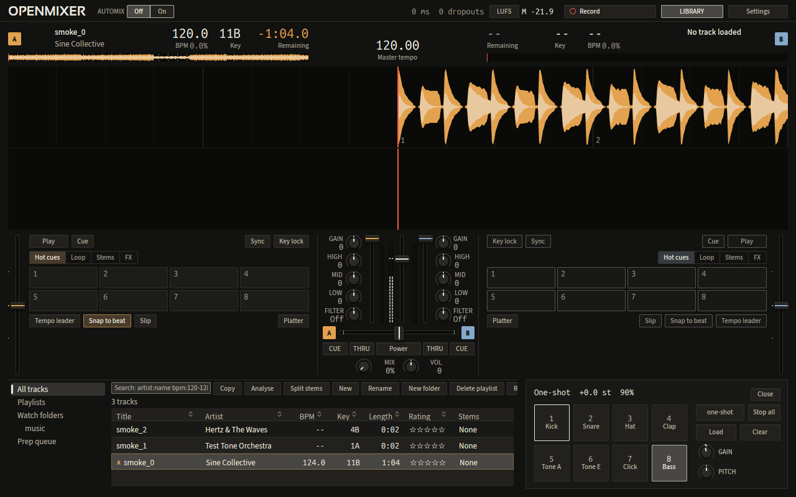
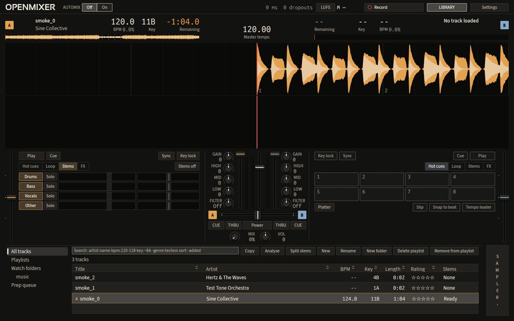
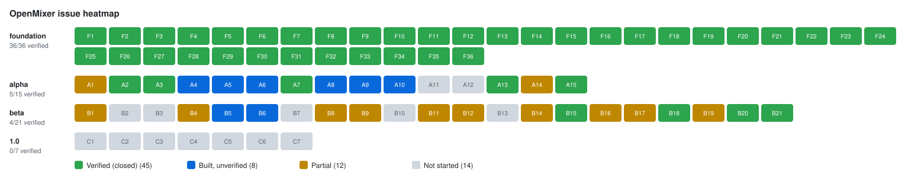

# OpenMixer

A free, open-source DJ application: Linux first, with Windows and macOS support to follow.

## Screenshots

Regenerate with `tools/screenshots.sh` (see `docs/screenshots/REVIEW.md` for known visual defects).

- Main window, dark theme: 
- Main window, daylight theme: 
- Deck looped, meters lit: 
- Sampler drawer open: 
- Stems tab: 

Built-in themes: Midnight Glass (`dark`, the default), Daylight Frost (`daylight`) and Harbour Night (`harbour`). Pick one under Settings, Appearance. Harbour Night has no screenshot yet.

## Mission

OpenMixer is a clean-room, legally original implementation of professional DJ software features. Our goal is a program a working DJ would choose over what they use now: djay-Pro-class capability (multi-deck mixing, effects, sync, BPM/key analysis, stem separation, Automix, controller support) with an interface that reads at a glance, all without copying any copyrighted expression from existing applications. The bar is in [docs/PRODUCT.md](docs/PRODUCT.md).

## Clean-Room Statement

OpenMixer is built under a strict clean-room doctrine:

- **Functional features are free** - mixing workflows, deck layouts, BPM detection, sync mechanisms, and other operational concepts are methods of operation, not copyrightable expression
- **Expression is not copied** - no names, logos, artwork, icons, screenshots, manual text, sound packs, FX presets, or pixel-copying of screen layouts
- **No Mixxx code** - while we use the same open-source audio libraries (GPL-licensed), our implementation is entirely original
- **No proprietary assets** - AI model weights are downloaded on first use from official sources with licenses shown; no content is bundled

## Technology

OpenMixer is written in Rust (toolchain and MSRV 1.95, pinned in `rust-toolchain.toml`) with [GPUI](https://www.gpui.rs/) for the UI. The workspace uses `gpui-pre` 0.3.10 (imported as `gpui`) and `gpui-kit` 0.8.1, and the app chrome (buttons, inputs, the library table, tabs, dialogs, toasts) is built on `gpui-component`; knobs, faders, meters, waveforms and the deck controls are painted by our own code. The stack decision is in [ADR 0004](docs/adr/0004-stack-rust-gpui.md); the platform refresh decisions are in `docs/spikes/DECISIONS.md`.


## Documentation

| Document | Purpose |
|----------|---------|
| [README.md](README.md) | Project overview (this file) |
| [docs/PRODUCT.md](docs/PRODUCT.md) | **What the product has to be: the bar every area is measured against** |
| [ROADMAP.md](ROADMAP.md) | Tracks, waves and key decisions |
| [agents.md](agents.md) | **AI Agent setup and implementation guide** |
| [CONTRIBUTING.md](CONTRIBUTING.md) | Contribution guidelines |
| [TODO.md](TODO.md) | Implementation task list |
| [docs/DESIGN_PATTERNS.md](docs/DESIGN_PATTERNS.md) | Design patterns in use and when to reuse them |
| [docs/PROGRESS.md](docs/PROGRESS.md) | Per-task progress, gaps, and where to help |
| [docs/adr/INDEX.md](docs/adr/INDEX.md) | Architecture decisions |
| [docs/spikes/DECISIONS.md](docs/spikes/DECISIONS.md) | Spike results and dated technical decisions |
| [docs/testing/hardware-checklist.md](docs/testing/hardware-checklist.md) | What a person has to confirm on real hardware after the platform refresh |
| [docs/legal/](docs/legal/) | Legal documentation |

## Building

### Prerequisites

Install the Rust toolchain with [rustup](https://rustup.rs/). The toolchain version is pinned in `rust-toolchain.toml`; `rustfmt` and `clippy` are installed with it.

**Ubuntu/Debian:**
```bash
sudo apt-get install pkg-config libasound2-dev libdbus-1-dev
```

GPUI system dependencies are documented in `docs/spikes/gpui.md`. Rubber Band's bindings need `libclang-dev` at build time (bindgen).

Optional: `sccache` shares compiled dependencies between worktrees (setup in `agents.md`); `libdbus-1-dev` is required on Linux by the default `realtime-dbus` feature (real-time priority for the audio callback); `--no-default-features` builds without it.

**macOS and Windows:** not runtime targets yet (Windows and macOS support is later). CI checks Linux only, so no extra system packages are listed for them yet.

Optional, for the licence and ban policy check:
```bash
cargo install cargo-deny
```

### Build Steps

```bash
# Clone the repository
git clone https://github.com/massive-development/openmixer.git
cd openmixer

# Build the workspace
cargo build

# Run tests
cargo test --workspace

# Engine soak: 30 s paced mix with a scripted DJ (also in cargo test --workspace)
cargo test -p om-audio --test soak
# 10-minute soak (Wave 2 gate; only the weekly CI job runs it): takes 10 minutes of wall time
cargo test -p om-audio --test soak -- --ignored --nocapture

# UI gate: scripted DJ over the composition on a paced mock device, no display (8 s; 10-minute run is --ignored)
cargo test -p openmixer --test ui_gate
cargo test -p openmixer --test ui_gate -- --ignored --nocapture

# Format, lint and policy checks (same as CI)
cargo fmt --all --check
cargo clippy --workspace --all-targets -- -D warnings
cargo deny check

# Benchmarks (divan): audio-thread and analysis hot loops, deck varispeed
cargo bench -p om-engine
cargo bench -p om-analysis

# Headless binary (no window, no GPUI system libraries at run time)
cargo test -p openmixer --no-default-features
```

### Running on WSL

GPUI renders through Vulkan, so the GUI on WSL depends on a working Vulkan driver as well as the display path. WSLg Vulkan can be fragile; check it with `vulkaninfo --summary` (from `vulkan-tools`) before debugging the app itself.

To run the GUI on Windows Subsystem for Linux (WSL):

**Windows 11 (WSLg):**
```bash
# Edit /etc/wsl.conf
[guiApplications]
enabled=true

# Restart WSL
wsl --shutdown
```

**Windows 10 or custom XServer:**
```bash
# Install and run VcXsrv or Xming on Windows
# Set DISPLAY environment variable
export DISPLAY=127.0.0.1:0

```

### Running

```bash
cargo run -p openmixer -- --mock-device              # the window (dev builds optimise the UI crates; use --release to judge smoothness)
cargo run -p openmixer -- --headless --smoke         # startup check, no window
cargo run -p openmixer -- --version
```

The GPUI window is the default build and needs the `-dev` packages listed in the `check` job of `.github/workflows/rust.yml` (on Linux: `libxkbcommon-x11-dev`, Wayland, fontconfig, freetype, Vulkan). `--no-default-features` builds the headless binary without it. The staged screenshots were checked by eye (see `docs/screenshots/REVIEW.md`); a live window on a real display, at the minimum size, has not been checked.

Set `OPENMIXER_FRAME_STATS=1` to print frame-time percentiles to the terminal every five seconds. Other environment variables: `OPENMIXER_PREFS` (preferences file), `OPENMIXER_LIBRARY_DB` (library database), `OPENMIXER_THEME` (theme id for the session), `OPENMIXER_WINDOW=WIDTHxHEIGHT` (window size), `OPENMIXER_WAVE_STYLE` (waveform style), `OPENMIXER_MOCK_STEMS` (mock stem separator), `OPENMIXER_DEMO_TRACK` (a real file for the demo deck) and `OPENMIXER_FFMPEG` (the `ffmpeg` executable).

Optional cargo features of the `openmixer` binary, all off by default: `clap` (CLAP plugin hosting through `om-plugins`, ADR 0007; Linux first), `onnx` (real stem separation through ONNX Runtime) and `ffmpeg` (decode fallback). `realtime-dbus` is on by default (Linux real-time priority; needs `libdbus-1-dev`); `--no-default-features` turns it off along with the window.

### Debug Build

```bash
cargo build
cargo run -p openmixer -- --smoke

# Check for memory leaks (Linux, requires valgrind)
valgrind --leak-check=full ./target/debug/openmixer --smoke
```

## Architecture

A Cargo workspace. Dependency arrows point toward `om-core`, which has no I/O.

```
crates/
├── om-core/      # Typed control surface (ParamId, Command), pulled engine snapshot, job queue, routing; no I/O
├── om-dsp/       # Filters, EQ, sweep filter, meters and crossfader curves
├── om-engine/    # Audio-thread engine: decks (rubato varispeed), mixer, FX racks, sync, quantizer, loops, sampler, recorder and EBU R128 loudness meter
├── om-audio/     # Device layer over cpal, a headless mock device, the output router; `realtime-dbus` feature (real-time priority on Linux)
├── om-stretch/   # Rubber Band R3 key-lock time-stretch via FFI (unsafe confined to `ffi.rs`)
├── om-analysis/  # BPM, key, waveform and structure analysis; job service and SQLite cache
├── om-library/   # SQLite library, metadata ingest, iTunes and Rekordbox import, search, prep queue
├── om-automix/   # Automix planner, controller and queue (control side only; no audio thread)
├── om-midi/      # Controller maps, MIDI learn, feedback, trace replay; `midir` and mock backends
├── om-stems/     # Stem separation pipeline (rubato resampling), model manifests, licence-gated verified downloads; ONNX backend behind the `onnx` feature (off by default)
├── om-plugins/   # In-process plugin API and registry; C-ABI shared-library loading; CLAP hosting behind the `clap` feature
├── om-ui/        # UI logic without a window: themes, preferences, mixer, deck and library view models
├── om-ui-gpui/   # GPUI window on gpui-kit and gpui-component (the openmixer `gui` feature, on by default)
├── om-testing/   # Test-only helpers shared by the crates (WAV fixtures, signal generators); dev-dependency only
└── openmixer/    # Binary and composition root: --smoke, --mock-device, settings, plugins
examples/plugins/gain-plugin/           # Example in-process plugin
examples/plugins/gain-plugin-cdylib/    # Example C-ABI plugin (ABI 1), built as a shared library
examples/plugins/param-plugin-cdylib/   # Example C-ABI plugin (ABI 2: prepare, parameters)
examples/plugins/clap-gain-fixture/     # CLAP test fixture plugin (built with clack-plugin)
fixtures/                               # Small test inputs: controller maps and traces, library exports
resources/controllers/                  # Generic controller maps
resources/fonts/                        # Bundled Inter (SIL OFL 1.1) interface font
resources/themes/                       # Built-in theme JSON
spikes/                                 # Throwaway spikes, each its own Cargo workspace (see docs/spikes/)
tools/                                  # Helpers: progress and issue heatmaps, docs check, screenshots, htdemucs export, CLAP leak check
```

Real-time audio code lives in `om-engine` and `om-audio`. It must not allocate, take locks or make syscalls on the audio thread. The UI sends typed `Command::Param`s to the router through `CommandSink`. MIDI mappings and plugins use the string façade, which parses each id once at the router. Readers pull an `EngineSnapshot` built from the engine's atomics. `agents.md` lists what each crate owns and how to add a control id.

## Implementation Waves



| Wave | Focus | Status |
|------|-------|--------|
| 1 | Foundation, build system, CI, test harness | ✅ Done |
| 2 | Audio engine (device, decks, mixer, FX, sync, MIDI input, soak gate) | 🟡 Partial: the debug panel (26a) is partial (no faders, EQ or meters on it); FFmpeg (8b) is an optional decode fallback; the 10-minute soak is on the weekly CI job, not yet run |
| 3 | Analysis pipeline | 🟡 Partial: stem separation runs on the mock separator; the htdemucs export and a real-model run (19) are open |
| 4 | Library and data | 🟡 Done except crates and tags, the Traktor and Serato importers, smart filters and ranking |
| 5 | User interface | 🟡 Partial: LookAndFeel (25) is partly restyled; decks, mixer and settings partial; stem pads (30) done at logic and view level |
| 6 | Hardware I/O | 🟡 Partial: MIDI input and mapping are done (32 and 33 are in Wave 2); the mapping editor (36) is in at logic and view level (Settings > Mapping, MIDI learn into it; not verified with hardware); generic controller maps (34) are built and not verified with a device, named-controller maps and HID (35) are open |
| 7 | Intelligence (stems, Automix, sampler) | 🟡 Partial: stem playback and the 8-pad sampler (engine, sample bank, pad strip; not heard) are in; Automix is in (planner, controller, library queue, Automix settings page, main-window bar; not heard, mock device only); stem separation is unproven; stem transitions are tested on the engine, not heard |
| 8 | Pro features (recording, broadcast, DVS, video) | 🟡 Partial: mix recording (master-output WAV, ids, prefs, Recording settings tab, header Record button and `r` shortcut; not heard); broadcast, DVS and video not started |
| 9 | Release | ⬜ Not started |

The engine, analysis, library and MIDI work is verified headlessly on Linux; the Wave 5 UI is partial. Next: the Before-Wave-7 list in [TODO.md](TODO.md), then Wave 7.

**Platform refresh (issues #218 to #229, #241, #250):** done and tested headlessly, not yet confirmed on real hardware. It moved the UI to `gpui-pre` 0.3.10 with `gpui-kit` and `gpui-component`, the toolchain to Rust 1.95, MIDI to `midir`, resampling and deck varispeed to `rubato`, added EBU R128 loudness metering (`ebur128`, with a panel in the mixer), OS media keys (`souvlaki`), GPUI file pickers, clipboard and notifications, SQLite `synchronous=NORMAL` in WAL mode for the library and analysis cache, hot-loop bounds-check work with `divan` benches, and CLAP plugin hosting behind the `clap` feature (ADR 0007; first-run, state and latency work still in progress). Real-time priority for the audio callback (issue #244) is on hold. The list of things a person has to check is `docs/testing/hardware-checklist.md`.

See [TODO.md](TODO.md) for the task list and [docs/PROGRESS.md](docs/PROGRESS.md) for what each task entails, what is done, and what is missing.

## Important Notices

- **No Spotify integration** - Spotify's terms of service prohibit DJ mixing operations
- **No mobile/web app** - the current development focuses on desktop platforms
- **Stems are precomputed** - stem separation runs offline; real-time separation is not promised

## License

OpenMixer is released under the GNU Affero General Public License v3.0 (AGPLv3). See [LICENSE](LICENSE) for details.

## Contributing

For contributors, see [CONTRIBUTING.md](CONTRIBUTING.md). All contributions must follow the clean-room doctrine outlined in [docs/adr/0001-clean-room-doctrine.md](docs/adr/0001-clean-room-doctrine.md).

## Status

**Current State:** Works, verified headlessly on Linux: the audio engine (two decks, mixer, FX racks, sync, key-lock), analysis (BPM, key, waveform, structure), the library (ingest, import, search, prep queue), MIDI (`midir`, mapping and feedback), in-process and C-ABI plugins, loudness metering, and the GPUI app on Linux. Partial: the UI (decks, mixer, settings, debug panel) and stems (mock separator only). The staged screenshots were checked by eye; a live window on a real display has not been. Windows and macOS support is later. **Next:** the Before-Wave-7 list in `TODO.md`, then Wave 7. See `docs/spikes/DECISIONS.md`.

**Known gaps, honestly listed:**

- Automix is not verified by ear (mock device only). It asks the prep queue to analyse tracks it had to skip as not analysed (up to 3 times per track, then it gives up and reports via `last_error`); that retry loop is not heard by ear. Stem transitions (Todo 39) are tested on the engine but not heard; the stem separation backend (Todo 19) is still open
- The real htdemucs model (Todo 19): the export script and I/O contract match Demucs on a reference segment (`crates/om-stems/tests/htdemucs_reference.rs`), but nothing has been listened to. The ONNX backend is behind the off-by-default `onnx` feature, and its CI job blocks merges. The separator interface and the licence-gated downloads are done
- CLAP hosting (issue #225, ADR 0007, `clap` feature of `om-plugins`, off by default): the host, the generic parameter panel and the plugin's own window are built and tested with an in-tree fixture plugin; first-run warning, plugin state save and restore, and latency compensation are in progress. No third-party CLAP plugin has been run by a person, and the Linux GUI paths (X11 embed, Wayland floating) are unverified on a real display
- Loudness metering (issue #222): the meter is checked against signals synthesised from EBU Tech 3341 and 3342, not the official EBU reference files (the EBU site refuses automated downloads); cases 6 to 8 and the programme cases are not covered. The mixer panel is checked in the headless gpui tests only
- Real-time priority for the audio callback (issues #228, #244): on Linux the `realtime-dbus` feature (on by default; needs `libdbus-1-dev`) asks rtkit for it. It has not been confirmed on a real device, and a `--no-default-features` build runs the callback at normal priority
- The platform refresh (UI on `gpui-component`, `midir`, `rubato`, media keys, desktop integration) was built on a host with no display, GPU, MIDI device or audio session. Visual parity with the older screenshots, real MIDI ports and the media keys are unverified; `docs/testing/hardware-checklist.md` lists what to confirm
- Deck varispeed through rubato (issue #241, sinc 128 by default, linear fallback): the last ~130 source frames of a track (about 3 ms) are not played, and no listening check has been done
- HID (Todo 35) and plug-and-play controller maps (Todo 34). The mapping editor (Todo 36) is done at logic and view level; it is not verified with hardware
- Dynamic plugin loading (Todo 10a): shared libraries load over a versioned C ABI (`PluginLoader::load`, ADR in `docs/spikes/DECISIONS.md`) (ABI 2 has `prepare`, sample rate and parameters; ABI 1 plugins still load). They are tested with in-tree plugins, one of them built from the C header alone (`crates/om-plugins/include/openmixer_plugin.h`); nothing from another language or a real third party has been tried. Plugins must catch their own panics and report a fault; the host passes audio through for a faulted instance
- Windows (WASAPI) and macOS (CoreAudio) runtime targets: later. The cpal device has not been run on a real ALSA or PipeWire device
- Visual verification of the GPUI window: the UI verification gate (Todo 31) runs at the logic layer. The staged screenshots were checked by eye (`docs/screenshots/REVIEW.md`), but no live window on a real display has been checked
- LookAndFeel (25): since the move to `gpui-component` (#223) buttons, inputs, the library table, sidebar rows, settings tabs, dialogs and toasts are component widgets themed through `om-ui-gpui::theme_bridge`, and the list below predates that move; `om_ui::style` derives every control style from the tokens and the custom-painted gpui controls draw from it; the library table, its scroll thumb and the automix switch draw from the new scroll bar, table and toggle styles; the platter switch, transport toggle pills, settings chips (MIDI toggles included), the settings card and the debug column draw from it too; the settings mapping table, Stems and Appearance text and menus are still on the old paths, and nothing has been checked on a live display. See "Styling a control" in `agents.md`. The debug panel's per-deck load and play (26a) is wired
- FFmpeg decode backend (Todo 8b, optional `ffmpeg` cargo feature, off by default): a fallback for the sampler, decks, stems and analysis when symphonia rejects a format (the file is decoded once to memory, capped at about 11 minutes for decks). The real-ffmpeg tests passed locally on ffmpeg 6.1.1 and skip where no ffmpeg or encoder is installed; CI runs the fake-ffmpeg tests (`cargo test` with the `ffmpeg` features) and is not known to have a real one
- Cover art shows in the deck card header only (PNG and JPEG; no track detail view; the cache is not invalidated on rescan); not seen on a display
- Playlist editing (Todo 28): reorder by dragging a track onto a row, a top-level New folder and nesting by drag are built; the gpui drag and drop is compile-checked only, not seen on a display
- The weekly `soak` CI job (the two 10-minute soaks, `.github/workflows/rust.yml`, Sunday 03:00 UTC) has not run yet: `gh run list --event schedule` is empty (checked 2026-10-27), so the result is unknown
- CI is Linux only; macOS and Windows legs are not in the check matrix
- The headphone-cue second stream is unproven (it failed on WSLg)
- The window-opening `--smoke` (without `--headless`) is not run in CI

---

Built with ❤️ for the DJ community.
